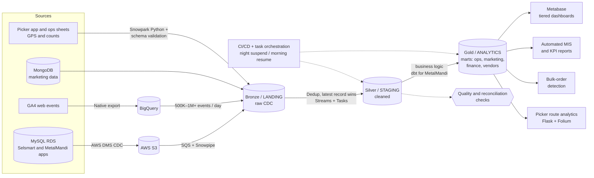
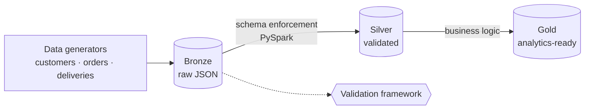
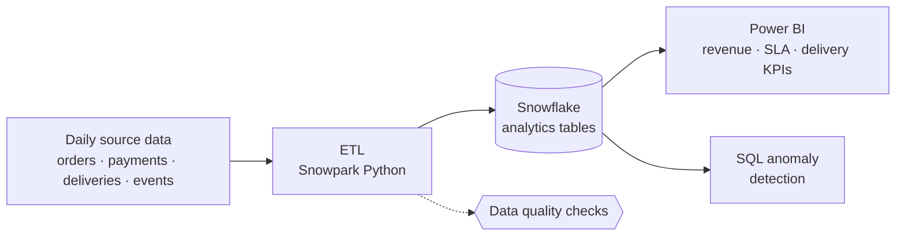

<h1 align="center">Shivam Mishra</h1>

  <b>Data Engineer · Analytics Engineer</b> 
  Snowflake · dbt · SQL · Python · GA4 · BigQuery · AWS

  I introduced Snowflake at my company and built the platform that its reporting now runs on, from ingestion to dashboards.

  
  
  

<b>🟢 Open to work</b> · Data Engineering · Snowflake Data Engineering · Analytics Engineering · Remote, hybrid or on-site (India)

---

## 🏆 Impact in numbers

*2.7+ years building data platforms end to end: sources → CDC and event pipelines → Snowflake → dashboards and automation.*

| Result | What I did |
|---|---|
| **Snowflake, from zero** | Introduced Snowflake at Attero and lead the platform: ~500 GB across 350+ tables for two businesses (Selsmart and MetalMandi), deployed through CI/CD |
| **1–2 min → 2–3 sec** | Cut report load time through query and model optimization |
| **30% lower compute** | Re-engineered Dynamic Tables into incremental Streams + Tasks as data volume grew, keeping near real-time freshness |
| **95% of reporting automated** | MIS and KPI reporting now runs on its own, saving 150+ hours a month |
| **90% auto-cleared** | Bulk-order detection algorithm on 30+ risk signals; only 10% of orders need manual review |
| **500K–1M+ events / day** | GA4 → BigQuery → Snowflake pipeline for marketing data |
| **30–35% → 55–60%** | Raised order pickup rate with SQL root-cause analysis and a 70:30 fresh-to-rescheduled allocation |
| **6 functions + partners** | Work with IT, Business, Logistics, Operations, Marketing, Finance and external partners to turn business needs into data products |
| **5–8 min → 30 sec** | Cut order-status investigation with a picker tracker that replaced a five-person manual process |

---

## 🧱 What I've built at work

*Described at a high level, because the code and data belong to my employer.*

**❄️ Snowflake platform, introduced and led end to end**
Brought Snowflake into the company and designed the architecture and data flow: ~500 GB across 350+ tables in the Selsmart and MetalMandi databases, on a Medallion (Bronze → Silver → Gold) design. Deployed through CI/CD, with task orchestration (dependency-ordered resume, nightly suspend), pipe health checks, failed-file tracking, row-count validation and runbooks.

**🔐 Governed by design**
RBAC with a least-privilege BI role, PII masking policies, and separate ingest, compute and BI warehouses so each workload is sized and billed on its own.

**🔌 Many sources, one source of truth**
CDC from MySQL (AWS DMS → S3 → Snowpipe), GA4 events through BigQuery, MongoDB for marketing data, and file-based picker data loaded with Snowpark Python and schema validation. Dedicated pipelines for vendor management, auditing and finance revenue and collection reconciliation.

**🧪 dbt for MetalMandi**
Introduced dbt to move MetalMandi transformations into version-controlled models.

**📣 Marketing data, measured on real orders**
GA4 → BigQuery → Snowflake replicates raw events (500K–1M+ a day) and models them in Snowflake (ELT). Combined with backend orders, it feeds a session → registration → order funnel, so campaigns are judged on confirmed orders instead of platform-reported conversions.

**🚚 Operations and risk analytics**
Bulk-order detection on 30+ risk signals (90% auto-cleared), route-adherence analytics with geolocation clustering, and a Picker Operations Analytics system for pickup performance and staffing. Delivered through tiered Metabase dashboards across 16+ warehouse locations.

**🤝 Built with the business, not just for it**
I sit with the teams that use the data: requirements come from IT, Business, Logistics, Operations, Marketing, Finance and external partners, and each dashboard tier is shaped by who needs to see what. Stakeholder management is the part of the job I'm strongest at.

### Production architecture

> **My rules:** one source of truth · incremental over full refresh (cost-aware) · governed access from day one · reconcile every automated number against the source · automate anything done more than twice.

---

## 🧪 Projects you can open

### ⚙️ [Enterprise Real-Time Data Platform](https://github.com/Shivam24012001/enterprise-real-time-data-platform)
`Python` `PySpark` `Bronze-Silver-Gold` `JSON`

Modular platform covering **ingestion → processing → validation → analytics-ready layers**, now growing into **LendPulse** (roadmap below).

- Reusable PySpark components that process structured JSON against predefined schemas
- Data-quality validator that fails a load on missing required fields and names the column and count, covered by pytest
- Production hygiene: secrets from `.env` via pydantic-settings, UTC timestamps, MinIO image pinned by digest
- Automated generation of logistics datasets (customers, orders, deliveries)
- **Run as Scrum:** 2-week sprints, user stories with acceptance criteria, one PR per story, sprint reviews and retros on a public GitHub Projects board

### 📦 [Logistics Analytics Platform](https://github.com/Shivam24012001/logistics-snowpark-platform)
`Snowflake` `Snowpark Python` `SQL` `Power BI`

End-to-end analytics across **orders, payments, deliveries and operational events**.

- Analytics-ready tables covering the full order lifecycle
- Power BI dashboards for revenue KPIs, SLA adherence and delivery performance
- Automated data-quality checks and SQL pattern matching for suspicious ordering behaviour

---

## 🧰 Tech stack

| | |
|---|---|
| **Snowflake** | Snowpipe · Streams & Tasks · Stored Procedures · Dynamic Tables · Snowpark · zero-copy cloning · cost optimization |
| **Data engineering** | CDC ingestion · ELT/ETL · dbt · CI/CD · orchestration · Medallion architecture · data quality testing |
| **Governance** | RBAC / least privilege · PII masking policies · separate ingest, compute and BI warehouses · runbooks |
| **Analytics** | Funnel, cohort and A/B analysis · regression, forecasting, clustering · root-cause analysis · risk scoring |
| **Ways of working** | Stakeholder management · requirements gathering · Agile/Scrum |

---

## 💼 Experience

**Data Analyst (Data Engineering) · Attero Recycling** · Jun 2025 – Present · Noida
Introduced Snowflake and lead the platform for Selsmart and MetalMandi: CDC, GA4 and MongoDB pipelines, dbt, governance, Metabase reporting and operations analytics, working with 6 functions and external partners (results above).

**Data Analyst · AlphaMetrics International** · Jan 2024 – Mar 2025 · Remote
Partnered with business and product stakeholders across 5+ verticals in Agile/Scrum sprints. Automated SQL and Python ETL pipelines (40%+ less manual effort), improved data quality by 30%, and built Power BI dashboards and funnel, cohort and A/B analyses.

**Education:** B.Tech, Electronics & Communication · Punjab Technical University · CGPA 8.4/10

---

## 🌱 What I'm building next: LendPulse

A lending risk platform for a simulated Indian NBFC (loan against property and personal loans), built in public with 2-week sprints. It extends the Enterprise Real-Time Data Platform above.

| Release | Target | What ships |
|---|---|---|
| v0.1 Foundation | Dec 2026 | Quarantine of malformed rows, retries, truthful README and tests *(in progress)* |
| v0.2 dbt on DuckDB | Feb 2027 | Lending schema, EMI engine, loan simulator, dbt staging, daily DPD and NPA classification, portfolio dashboard |
| v0.3 Orchestrated | Apr 2027 | CI on every PR, chaos injection, Airflow running dbt, backfills, reconciliation that fails the run on any gap |
| v0.4 Risk analytics | May 2027 | SCD2 snapshots, incremental facts, roll rates and vintage curves, public dbt docs and lineage |
| v1.0 Portfolio-ready | Jun 2027 | The same dbt project on Snowflake, PII masked by role, measured SLOs and a demo video |

After v1.0: CDC with Debezium and Redpanda, a Databricks lakehouse, real-time bounce alerts and a governed AI agent for credit questions.

Also next at work: **graph-based bulk-order detection** in Snowflake (orders and entities as nodes, shared attributes as edges).

---

  <a href="https://www.linkedin.com/in/shivammishra-sm/"><b>📩 Connect on LinkedIn</b></a> &nbsp;·&nbsp; <a href="mailto:sm8954223@gmail.com"><b>✉️ Email me</b></a>

