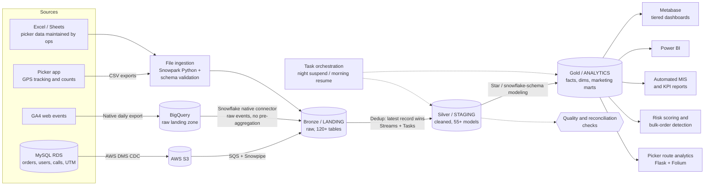
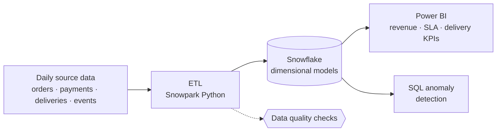
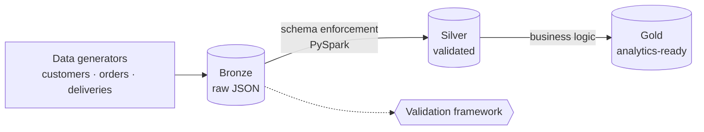

<h1 align="center">Shivam Mishra</h1>

  <b>Analytics Engineer · Data Analyst</b> 
  Snowflake · SQL · Python · PySpark · Metabase · Power BI

  I turn messy operational data into automated pipelines and dashboards that a business actually runs on.

  
  
  

<b>🟢 Open to work</b> · Data Engineering · Analytics Engineering · Senior Data Analyst · Remote, hybrid or on-site (India)

---

## 🏆 Impact in numbers

*2.6+ years owning reporting ecosystems end to end: requirements → Snowflake models → automated pipelines → dashboards.*

| Result | What I did |
|---|---|
| **30–35% → 55–60%** | Raised order pickup rate by running SQL root-cause analysis and proposing a 70:30 fresh-to-rescheduled allocation strategy |
| **150+ hours / month** | Eliminated manual MIS and KPI reporting; turnaround went from days to minutes |
| **30% lower compute** | Re-architected Snowflake Dynamic Tables into incremental Streams + Tasks, keeping near-real-time freshness |
| **5–8 min → 30 sec** | Cut order-status investigation time with an Order & Picker Journey Tracker |
| **30+ signals** | Built an SQL risk scoring framework that replaced a manual review of up to 10 minutes per order |
| **5-person process → 0** | Replaced a manual picker-operations process with automated analytics |
| **40%+ less manual effort** | Automated SQL and Python ETL pipelines at my previous role |
| **30% better data quality** | Validation frameworks, QA and governance for critical datasets at my previous role |

---

## 🧱 What I've built at work

*Described at a high level, because the code and data belong to my employer.*

**❄️ A single source of truth**
Built a centralized Snowflake warehouse on a Medallion (Bronze-Silver-Gold) architecture. It combines operational database changes (CDC), GA4 events, app exports and spreadsheet data, and serves IT, Business, Logistics, Operations, Marketing and Finance. Quality and reconciliation checks run after loading (freshness, update timestamps, nulls) so numbers are checked before anyone sees them.

**🏗️ Production platform, end to end**
MySQL RDS → AWS DMS (CDC) → S3 → Snowpipe → Medallion layers: **120+ landing tables, 55+ staging models, 30+ analytics tables**, with task orchestration (dependency-ordered resume, nightly suspend), pipeline monitoring, RBAC and runbooks. File-based sources (picker-app GPS exports, Excel-maintained picker data) are loaded with Snowpark Python and schema validation.

**📣 Marketing data, measured on real orders**
Set up a GA4 → BigQuery → Snowflake pipeline that replicates raw events and models them in Snowflake (ELT). It feeds a session → registration → order funnel, so campaigns are judged on backend-confirmed orders instead of platform-reported conversions. Reconciling GA4 numbers against warehouse orders is in progress.

**🚚 Operations and risk analytics**
Route-adherence analytics with geolocation clustering, a Picker Operations Analytics system for pickup performance and staffing, and an SQL risk scoring engine. Delivered to leadership through tiered Metabase dashboards.
**In progress:** upgrading bulk-order detection to a **graph-network method in Snowflake** (nodes: orders and entities, edges: shared attributes).

### Production architecture

> **My rules:** one source of truth · incremental over full refresh (cost-aware) · reconcile every automated number against the source · automate anything done more than twice.

---

## 🧪 Projects you can open

### 📦 [Logistics Analytics Platform](https://github.com/Shivam24012001/logistics-snowpark-platform)
`Snowflake` `Snowpark Python` `SQL` `Power BI`

End-to-end analytics across **orders, payments, deliveries and operational events**.

- Dimensional models supporting analysis across the full order lifecycle
- Power BI dashboards for revenue KPIs, SLA adherence and delivery performance
- Automated data-quality checks and SQL pattern matching for suspicious ordering behaviour

### ⚙️ [Enterprise Real-Time Data Platform](https://github.com/Shivam24012001/enterprise-real-time-data-platform)
`Python` `PySpark` `Bronze-Silver-Gold` `JSON`

Modular platform covering **ingestion → processing → validation → analytics-ready layers**.

- Reusable PySpark components that process structured JSON against predefined schemas
- Validation framework that flags data-quality issues *before* downstream processing
- Automated generation of logistics datasets (customers, orders, deliveries)

---

## 🧰 Tech stack

| | |
|---|---|
| **Data engineering** | Medallion architecture · Snowpipe · Streams & Tasks · Dynamic Tables · incremental processing · Snowpark Python · ETL/ELT |
| **Data modeling** | Conceptual, logical and physical models · Star Schema · semantic layers (Metabase, Power BI) · data dictionary · dbdiagram.io |
| **Analytics** | Funnel, cohort, A/B and ROI analysis · regression, forecasting, clustering · root-cause analysis · risk scoring · graph methods in SQL (in progress) |
| **Quality & governance** | Validation and reconciliation checks · metadata documentation · RBAC / least privilege |

---

## 💼 Experience

**Data Analyst · Attero Recycling** · Jun 2025 – Present · Noida
Owns reporting end to end: Snowflake warehouse, GA4 marketing pipeline, tiered Metabase dashboards, risk scoring and operations analytics (results above).

**Data Analyst · AlphaMetrics International** · Jan 2024 – Mar 2025 · Remote
Built Power BI and Tableau dashboards across 5+ business verticals, ran funnel, cohort, A/B and ROI analyses, and automated SQL and Python ETL pipelines (40%+ less manual effort).

**Education:** B.Tech, Electronics & Communication · Punjab Technical University · CGPA 8.4/10

---

## 🌱 What I'm building next

- **dbt and orchestration:** tested, versioned transformations and scheduled pipelines (Airflow-style)
- **Advanced PySpark:** partitioning, performance tuning and structured streaming
- **AI agents for routine work:** report refresh checks, pipeline health summaries and anomaly explanations

---

  <a href="https://www.linkedin.com/in/shivammishra-sm/"><b>📩 Connect on LinkedIn</b></a> &nbsp;·&nbsp; <a href="mailto:sm8954223@gmail.com"><b>✉️ Email me</b></a>

